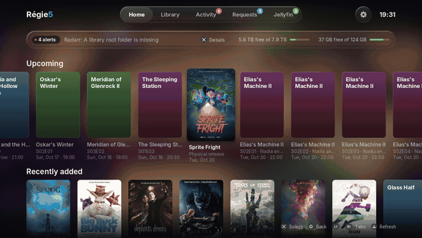
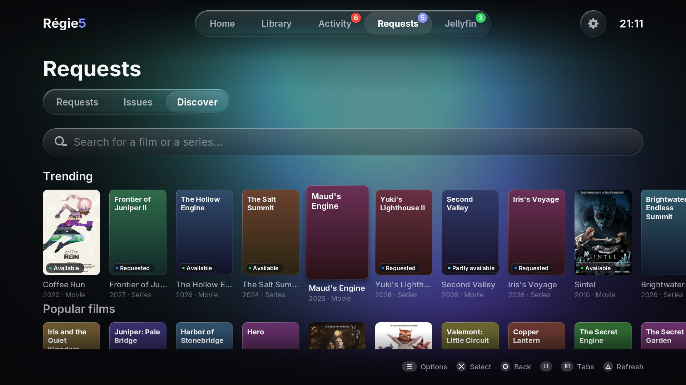
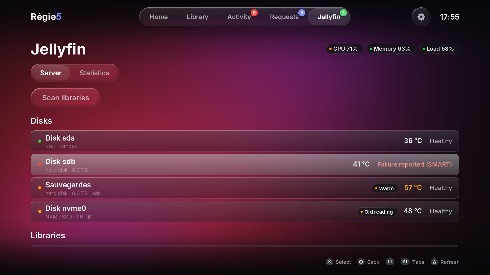
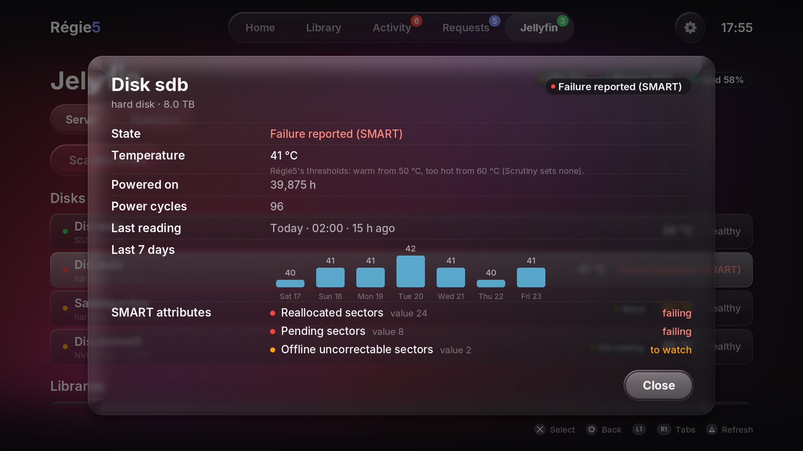
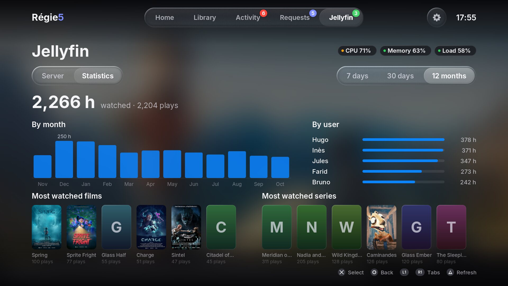

<p align="center">
  
</p>

<h1 align="center">Régie5</h1>

<p align="center">
  <b>Your self-hosted media stack, on the TV, from your PS5.</b><br>
  A native PS5 homebrew app to keep an eye on Sonarr, Radarr, Seerr and Jellyfin
  (or Emby, or Plex) from the couch, with a controller.
</p>

<p align="center">
  
</p>

Régie5 (French for a TV control room) is for people who run their own Jellyfin (or Emby,
or Plex) server with the *arr apps and have a jailbroken PS5 under the TV. It shows what is
coming, what is downloading, who is watching and how well, and lets you act on the
few things worth doing from the couch: approve a request, stop a stream, scan the
libraries, free some space.

Everything stays on your local network: Régie5 talks only to your own servers,
never to the internet. (Signing in to Plex is the one exception, and it happens on your
phone, which reaches plex.tv: the console still does not.)

## Features

<p align="center">
  
</p>

| | |
|---|---|
| **Home** | Upcoming episodes and films (14 days, Sonarr + Radarr calendars), recently added to Jellyfin, disk space and health alerts of every instance, and failing or hot disks through [Scrutiny](https://github.com/AnalogJ/scrutiny) if you use it (new in 0.8.0). |
| **Library** | Your series and films (read-only), a week-by-week **TV guide**, what is **missing**, and an optional **Cleanup** view. |
| **Activity** | The download queue of Sonarr and Radarr merged (title, progress, time left, status; refreshed every 5 s), and a 14-day **log**: imports, Seerr requests, Jellyfin playback and sign-ins, health alerts. |
| **Requests** | Seerr requests (pending / approved / all), with **Approve** and **Decline**; Seerr **issues** (open / resolved / all) with their comments, **Resolve** and **Comment** (ready-made sentences); **Discover**: search Seerr with the console's keyboard, trending, popular and upcoming films and series, a title's page, and **request** it (the seasons, 4K, the quality profile and folder). |
| **Jellyfin** | Who is watching what, Direct Play or transcoding and **why**, a **playback diagnosis** (source vs. sent to the client, hardware acceleration, "is the transcode keeping up?", advice), **Stop playback**, **Scan libraries**, your **libraries** (how many films, series and episodes, and their size) and **users** (when each was last active), scheduled tasks, server load through [Glances](https://nicolargo.github.io/glances/) and **disk health** through [Scrutiny](https://github.com/AnalogJ/scrutiny) (state, temperature, a sheet per disk) if you use them; **viewing statistics** (new in 0.8.0: hours watched by day, month and user, most-watched films and series over 7 days, 30 days or 12 months) with Jellyfin's Playback Reporting plugin. |
| **Settings** | Connection state of every service and instance, version, Cleanup on/off, **display refresh** (Auto, which asks for 120 Hz / 60 Hz / 120 Hz), **set-up from a phone** (QR code), **Quick Connect** for Jellyfin (no API key to copy), the **set-up screens** and **What's new** again. |

Also:

- **Counters on the tabs**: downloads in the queue, requests waiting for an answer, people watching.
- **Emby** in Jellyfin's place (**beta**): the same screens, which then say *Emby*.
- **Plex** in Jellyfin's place (**beta**, new in 0.6.0): the same screens, which then say *Plex*;
  sign in from the phone page. **Plex users: please [open an issue with your feedback](https://github.com/viviandsx/regie5/issues/new?template=plex_feedback.yml),
  even if everything works.**
- **Set-up screens** at the first start: choose your media server, scan a QR code, fill in a page on your phone.
- **Several instances** of a service (for example Radarr and Radarr 4K) are shown together, each named.
- **HTTPS** and reverse-proxy sub-paths (`https://example.lan/sonarr`), self-signed certificates on request.
- **Liquid-glass interface** made for a TV: large type readable from 3 m, a springy focus drop, 4K at 60 fps,
  120 Hz on a display that accepts it, 60 Hz on the others. New texts and posters are prepared a little
  in each frame, so that opening a screen does not stutter (0.7.0).
- **Large libraries, slow servers** (0.7.0): a library of thousands of films is read with little memory and
  read once for every screen; a poster already received is never asked again; a slow or switched-off server
  no longer holds up the others, and the one being waited for is named at the bottom of the screen.
- **Japanese, Chinese and Korean titles** are shown (new in 0.7.0), with a font read only when such a
  title appears.
- **English, French, Spanish and German**, following the console's language. The Spanish and German
  translations were made with the help of AI: corrections by native speakers are welcome, and so are
  [new languages](docs/TRANSLATING.md).

<p align="center">
  
  
  
  
  
  
  
  
  
  
  
  
  
  
  
</p>

<sub>Screenshots and animation: the desktop build in demo mode (`--demo`), no server involved. The films and
the series shown are the Blender Foundation's open movies (Big Buck Bunny, Elephants Dream,
Sintel, Tears of Steel, Cosmos Laundromat, Spring, Coffee Run, Sprite Fright, Charge,
Caminandes), with their posters and stills from Wikimedia Commons under CC BY 3.0 / 4.0
(© Blender Foundation | studio.blender.org), resized or cropped; every other title is made
up and gets Régie5's generated cover. Full credits: [demo/CREDITS.md](demo/CREDITS.md).</sub>

### What Régie5 changes on your servers

Almost nothing, and never without asking. It is read-only, except for these
actions, each behind a confirmation whose focus starts on **Cancel**:

- approve or decline a Seerr request; **request** a film or a series in Seerr (as the
  account of the API key: Seerr's administrator, so the request is usually approved at once);
- resolve a Seerr issue, or post one of a few ready-made comments on it;
- stop a Jellyfin, Emby or Plex playback session; scan its libraries; with Quick Connect,
  sign in to Jellyfin (Régie5 then appears among its devices); with Plex, sign in from
  the phone (Régie5 then appears among the Plex account's devices);
- **Cleanup** (off by default): delete a film or a series **with its files** in
  Radarr/Sonarr, always added to the import-list exclusions so no list brings it
  back. It is turned on in Settings after a warning, offers only titles watched
  and finished (by every active account, or at least one, as you choose) and not
  watched for months, never favourites; every deletion asks twice, one at a time.

### What Régie5 will never do

No download client, no indexer, no release search, no release or tracker names
anywhere: Régie5 shows titles, progress and quality, nothing else. Its activity
log never reads Jellyfin's or Emby's free-text fields (which hold IP addresses and
device names), nor Plex's addresses and devices.

## Requirements

- A **jailbroken PS5** with [ShadowMount+](https://github.com/drakmor/ShadowMountPlus),
  which turns folders in `/data/homebrew/` into home-screen tiles. Tested on
  firmware **13.60**.
- A way to copy a folder to the console: **ps5upload** or an **FTP** payload.
- At least one of the services below, reachable from the console on your local
  network, with its API key (Plex: a sign-in from the phone).

### Services and versions

| Service | Minimum | Tested with | Used for |
|---|---|---|---|
| [Sonarr](https://sonarr.tv) | 4.0 | 4.0 | calendar, queue, series, health, disk space, history; Cleanup |
| [Radarr](https://radarr.video) | 5.0 | 6.4 | calendar, queue, films, health, disk space, history; Cleanup |
| [Seerr](https://github.com/seerr-team/seerr) | 2.0 (Jellyseerr 2.x works too) | 3.5 | requests, approve / decline, issues (resolve, comment), Discover (search, trending, popular, upcoming) and new requests, posters through its image proxy |
| [Jellyfin](https://jellyfin.org) | 10.9 | 12.2 | sessions, playback info, recently added, libraries, users, activity log, scheduled tasks; Quick Connect sign-in |
| [Emby](https://emby.media), in Jellyfin's place (**beta**) | 4.8 | 4.10.1 | the same as Jellyfin; *Find in Emby5* instead of Jelly5 |
| [Plex Media Server](https://www.plex.tv), in Jellyfin's place (**beta**) | 1.41.9 | 1.43.4 | the same as Jellyfin but Cleanup; the log shows finished playbacks; *Find in Plex* instead of Jelly5 |
| [Glances](https://nicolargo.github.io/glances/) (optional) | 4.0 (API 4) | 4.x | server load |
| [Scrutiny](https://github.com/AnalogJ/scrutiny) (optional) | 0.8 | 0.9.5 | disk health (SMART, temperature), read-only ([guide](docs/SCRUTINY.md)) |
| [Playback Reporting](https://github.com/jellyfin/jellyfin-plugin-playbackreporting), a Jellyfin plugin (optional) | — | 19 | viewing statistics, read-only ([guide](docs/STATISTICS.md)); not with Emby or Plex yet |

Each service is optional: a service turned off simply leaves its sections out.
Settings tests every service and says plainly when one does not answer as expected,
or when its version is older than the minimum above ("Version too old"). Versions
between the minimum and the tested one should work but have not been tried; reports
are welcome. Overseerr 1.x is not supported (it has no Jellyfin links).

## Install

1. Download `PPSA99520.zip` from the [latest release](https://github.com/viviandsx/regie5/releases/latest).
2. Unzip it on your computer: it holds a single folder, `PPSA99520`.
3. Copy that whole folder into `/data/homebrew/` on the console (ps5upload or FTP),
   so that `/data/homebrew/PPSA99520/eboot.bin` exists.
4. Wait about ten seconds: ShadowMount+ adds the **Régie5** tile to the home screen, under **Games**.
5. Open Régie5: at the first start, its set-up screens open (see below).

**Updating:** copy the new `PPSA99520` folder over the old one. A release never
contains a `config.json`, so yours is kept and the set-up screens do not open.
0.3.0 put the tile under Media; since 0.3.1 it is under Games (the Media area does
not let the app open the phone page): it moves by itself after the copy.
**Uninstalling:** delete `/data/homebrew/PPSA99520`.

The same steps, in English and French, are in `INSTALL.txt` inside the zip.

## Set up

### At the first start

When there is no `config.json` yet (or one Régie5 cannot read, or with every service
off), Régie5 opens its set-up screens:

1. **Get started**, then choose your media server: **Jellyfin**, **Emby**, **Plex** or **None**.
2. A QR code and a 6-digit code appear: fill in the page on your phone, as below.
3. Régie5 tests every service, as Settings does. **Start** opens the Home screen;
   **Fix from the phone** goes back to the page.

**Later** closes them at any step, and they do not open by themselves again: the Home
screen offers **Set up** until a service is set, and **Settings › Setup** opens them
at any time. A `config.json` that could not be read is kept beside the new one, as
`config.json.invalid`.

If Régie5 closes twice in a row right after starting with the same `config.json`, the
next start does not load it (the file is not changed): the Home screen and Settings say
so and the set-up screens open, to fix it from the phone. **Test all** in Settings reads
the file again.

### From your phone (recommended)

1. In Régie5, press **R1** until the gear (**Settings**) is selected.
2. Choose **From a phone**: a QR code and a 6-digit code appear on the TV.
3. Scan the QR code with your phone, on the same network as the console (or type
   the address shown on the TV into the phone's browser).
4. Fill in each service: its address with the port (`http://192.168.1.10:8989`,
   `https://example.lan/radarr`…) and its API key. Tick **Self-signed
   certificate** for an `https://` address whose certificate is self-signed.
5. Tap **Save on the console**: Régie5 tests every service, and each should get a
   green dot.

The page is served by the console on your local network only, while that window
is open, and needs the code. Keys already saved are never sent back to the phone:
a key field left empty keeps the saved key.

### Jellyfin without an API key: Quick Connect

Give Jellyfin's address only (no key), then choose **Quick Connect** on the set-up
screens' check, or in Settings on Jellyfin's line (Options). A 6-digit code appears on
the TV: on your phone, in Jellyfin (the app or a browser), open your profile ›
**Quick Connect** and type it. Régie5 then uses that account's session, kept in
`config.json`. Sign in with an **administrator** account: stopping a stream, scanning,
the scheduled tasks, the activity log, the users and Cleanup need one; with another
account Régie5 says so where it matters (Jellyfin's line in Settings turns orange). If
the session is removed in Jellyfin (*Dashboard › Devices*), Settings says so: run Quick
Connect again. An API key, when there is one, is used instead. Emby has no such thing on
the local network: it keeps its API key.

### Plex (beta): sign in from the phone

Give Plex's address (port 32400) on the phone page, then tap **Sign in to Plex**: Plex's
own sign-in page opens on the phone (the phone needs the internet for it, the console does
not). Régie5 finds your server among the account's (or asks which one) and saves its
token on the console. **For the server's owner, the token Plex gives is the Plex account's
own**: it is kept in plain text in `config.json` on the console, and it opens the whole Plex
account, not just this server. Removing "Regie5" from the account's devices does **not**
end it (tried); to really revoke it, change the Plex account's password on plex.tv and tick
*Sign out connected devices* (this signs every app and server out of the account). To keep
no token at all on the console, set the Plex server's *List of IP addresses and networks that
are allowed without auth* (Settings › Network) to the console's address only and leave the
token empty: Régie5 then gets the owner's rights on that server alone, which Plex advises
against; removing the address revokes it. Sign in as the **server's owner**: what is playing, stopping a
stream, scanning, the tasks, the log and the users need it. A token can also be pasted by
hand (the page says where to find one). Plex 1.41.9 or later.

### By file

Copy `config.example.json` (in the app folder) to `config.json` in
`/data/homebrew/PPSA99520/`, fill it in on a computer, copy it to the console, then
choose **Test all** in Settings. Several instances of a service are a list of named
instances; the fields are described in `config.example.json`.

Where the API keys are: Sonarr and Radarr, *Settings › General › Security*; Seerr,
*Settings › General*; Jellyfin, *Dashboard › API Keys* (or Quick Connect, above); Emby, in the server's settings,
*Advanced › Api Keys › New Api Key*.

**Emby instead of Jellyfin:** write `"emby"` in `config.json` where the example has
`"jellyfin"` (same fields: `url`, `apiKey`). The tab, the texts and the log then say
*Emby*. **Plex:** `"plex"` with its `url`; its `token` comes from the phone page. One media
server at a time (with several on, Jellyfin, then Emby, then Plex is used, and Settings
says so).

Behind a **reverse proxy**, the address may carry a path
(`https://media.lan/sonarr`); see [docs/CONFIG.md](docs/CONFIG.md) (in French) for the
two ways to set the proxy up, and for redirects such as a login page in front of it.

## Controls

| Button | Action |
|---|---|
| D-pad / left stick | move |
| ✕ | select |
| ○ | back |
| L1 / R1 | previous / next tab |
| L2 / R2 | previous / next letter (lists by title), week (guide) or page |
| △ | refresh the screen |
| Options | the selected item's menu (approve / decline, resolve / comment, keep / delete, find in Jelly5, Emby5 or Plex) |
| □ | Discover: clear the search |

## Known limitations

- **No "Open in Jelly5".** The console does not let one app start another
  (`sceSystemServiceLaunchApp` and `sceLncUtilLaunchApp` are not available to
  apps). Options › **Find in Jelly5** tells you which title to look for in
  [Jelly5](https://github.com/02dnot/Jelly5) instead.
- **Emby is in beta** (new in 0.4.0, marked *beta* in Settings): tested on the
  console against Emby 4.10.1.0, not yet on a real Emby server with its users and
  Emby Premiere. Cleanup with Emby is covered by the tests only so far. Reports
  are welcome in [issue #1](https://github.com/viviandsx/regie5/issues/1).
- **Plex is in beta** (new in 0.6.0, marked *beta* in Settings): tested against a test
  server without Plex Pass, not yet on a real one. Plex gives no reason for a transcode:
  the diagnosis works them out from the session and says so. Stopping a stream seems to
  need **Plex Pass** (Plex refused it on the test server; Régie5 says so). **No Cleanup
  with Plex** for now: Plex does not show what other accounts are in the middle of
  watching. The log shows finished playbacks only (Plex keeps no activity log). Every
  report helps: [Plex feedback](https://github.com/viviandsx/regie5/issues/new?template=plex_feedback.yml).
- **Requests made from Régie5** are made as the account of Seerr's API key (its
  administrator), not as one of Seerr's users: they count against no one's quota and
  are usually approved at once. Asking on behalf of another user is not possible yet.
- **Seerr after a Cleanup deletion:** Seerr has no API to mark a title deleted.
  Its own *Media Availability Sync* job (nightly by default, or run by hand in
  Seerr › Settings › Jobs) marks it deleted, keeps its requests and lets it be
  requested again.
- **HTTPS on the console** uses TLS 1.2 (ECDHE with AES-GCM, ChaCha20-Poly1305 or
  AES-CBC; RSA and ECDSA certificates). A server that only accepts TLS 1.3 cannot be
  reached from the console.
- **120 Hz** needs a display and a link that take it. Auto asks for it and stays at
  60 Hz on a display that refuses it; 120 Hz chosen by hand says so in Settings. A
  change applies at the next start. A TV that takes 120 Hz only at a lower resolution
  may be sent that resolution: choose 60 Hz (Settings › Display refresh) to keep 4K.
- **Viewing statistics** need Jellyfin's Playback Reporting plugin, and count from the day
  it is installed (it keeps 3 months by default: choose *Forever* in its settings for a
  year). Not with Emby or Plex yet. A film or series shows its poster when Radarr or
  Sonarr knows it under the same title; else a generated card.
- **Disk temperatures**: Scrutiny sets no threshold; Régie5 calls a hard disk or SATA SSD
  warm from 50 °C and too hot from 60 °C (an NVMe SSD from 70 °C and 80 °C).
- **Library sizes** come from Radarr and Sonarr (Jellyfin gives none): a title they
  do not know is counted but not measured, and the Jellyfin tab says how many were.
- `config.json` holds your API keys in plain text on the console, and with Plex the
  owner's **Plex account token** (Plex has no token limited to one server that the
  console could keep): see *Plex (beta): sign in from the phone* for how to revoke it.
- **Other scripts** (Arabic, Hebrew, Thai, Devanagari…) are shown as □: they need a
  right-to-left layout or joined letters that Régie5 does not do yet. Latin, Greek,
  Cyrillic, Japanese, Chinese and Korean are shown.
- **Very large libraries:** a library list larger than 32 MB as sent by the server
  (some 8,000 films in Radarr) is not read on the console, so that it cannot run out of
  memory: the Library then says *Library too large for Régie5* for that instance.
- Only firmware 13.60 has been tested.

## Building from source

Régie5 is developed on Linux, where the same app runs in a window (keyboard or
DualSense through SDL), and can run on sample data with no server at all.

```bash
# Debian / Ubuntu
sudo apt install build-essential clang cmake ninja-build libsdl2-dev libfreetype-dev libcurl4-openssl-dev libgl-dev

scripts/run-linux.sh --demo              # demo mode: open films with their posters, no server contacted
scripts/run-linux.sh --mock              # test data (made-up titles), no server contacted
scripts/run-linux.sh                     # with ~/.config/regie5/config.json
cmake --build build/linux && ctest --test-dir build/linux
```

On the keyboard: arrows, Enter (✕), Escape (○), Q/E (L1/R1), Z/C (L2/R2), R (△), X (□),
M (Options).

The PS5 build needs the [ps5-payload-sdk](https://github.com/ps5-payload-dev/sdk),
pacbrew and LLVM (`clang`, `lld`, `llvm`):

```bash
scripts/setup-ps5-toolchain.sh           # the SDK and pacbrew, checksums verified
scripts/release-ps5.sh                   # build/ps5/release-<version>/upload/PPSA99520.zip
```

The design and the porting notes are in `docs/` (in French).

## Contributing

Bug reports and ideas are welcome in the issues. Please read the scope above
first: features around download clients, indexers or release searching will not
be added. [docs/CONTRIBUTING.md](docs/CONTRIBUTING.md) says how to report a bug,
suggest an idea, translate or change the code, and the rules every change follows.

**Translations** are welcome too: a language is a single file, and
[docs/TRANSLATING.md](docs/TRANSLATING.md) explains how to add one.

## How Régie5 was made

Régie5 was entirely "vibe-coded" with **Claude Opus 5.5** (Anthropic). Vivian defined
the project, made every product and design decision, tested each step on Linux and
on the console against a real server, and published it; the code and the
documentation were written by the AI.

## License and credits

Régie5 is free software under the **GNU General Public License v3.0 or later**
(see [LICENSE](LICENSE)).

It builds on the work of others, listed with their licences in
[THIRD_PARTY_NOTICES.md](THIRD_PARTY_NOTICES.md), among them:
[Jelly5](https://github.com/02dnot/Jelly5) (the liquid-glass interface it is
modelled on), [OverShifted/LiquidGlass](https://github.com/OverShifted/LiquidGlass),
BlackBearReloaded's [ps5-opengl](https://github.com/blackbearreloaded/ps5-opengl) and
[ps5-homebrew-ui](https://github.com/blackbearreloaded/ps5-homebrew-ui), the
[ps5-payload-sdk](https://github.com/ps5-payload-dev/sdk),
[Mbed TLS](https://github.com/Mbed-TLS/mbedtls), [cJSON](https://github.com/DaveGamble/cJSON),
[stb_image](https://github.com/nothings/stb), Nayuki's
[QR Code generator](https://www.nayuki.io/page/qr-code-generator-library),
[FreeType](https://freetype.org), the [Inter](https://github.com/rsms/inter) typeface and a subset of
[Noto Sans CJK](https://github.com/notofonts/noto-cjk).

Régie5 is not affiliated with or endorsed by Sony Interactive Entertainment, the
Jellyfin project, Emby, Plex, or the Sonarr, Radarr or Seerr projects. *PlayStation*, *PS5* and
*DualSense* are trademarks of Sony Interactive Entertainment Inc.
